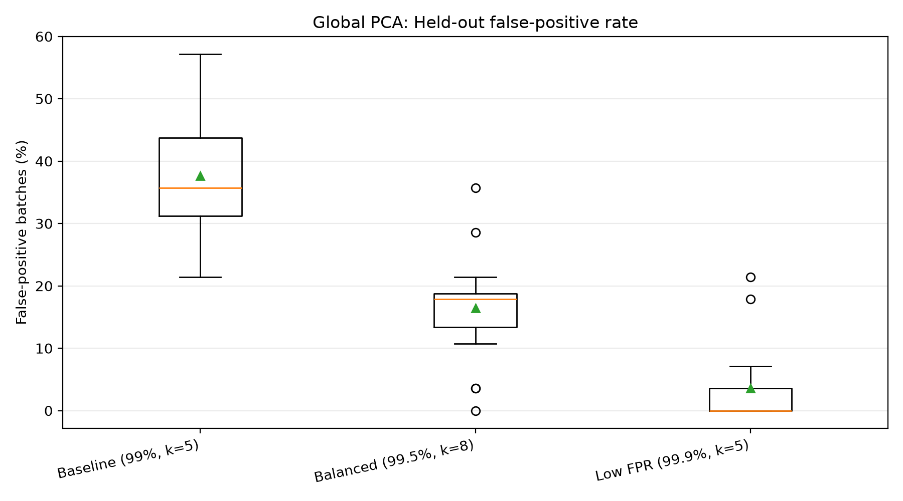
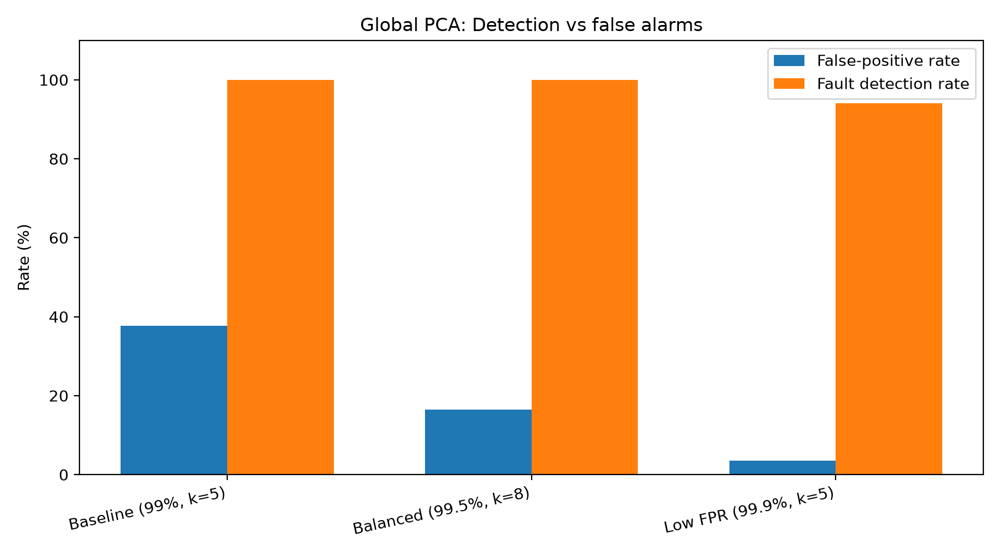
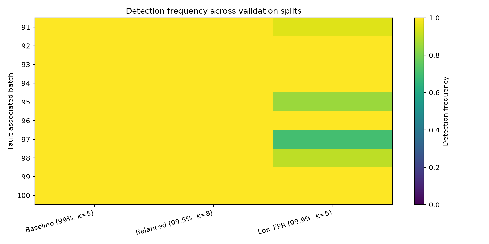

# Data-Driven Analysis and Predictive Modeling of Industrial Fermentation Processes

**Research question:** Can fermentation process parameters predict production performance and identify process deviations?

This Python portfolio project investigates the **IndPenSim** industrial-scale penicillin fermentation simulator through four complementary analyses: exploratory data analysis, statistical testing, predictive modeling, and multivariate fault detection. The data are **simulated**, not measurements from a production plant.

## Key findings

The clearest completed result is an improvement in PCA-based anomaly monitoring. Across **20 repeated batch-level splits**, a calibrated alarm reduced the mean batch-level false-positive rate from **37.7% to 16.4%** (a **56.5% relative reduction**) while maintaining **100% observed fault-associated batch detection**. Median detection delay increased from 0.90 to 1.60 hours.

These results come from repeated splits of the *same* 100-batch dataset, with the same 10 fault-associated batches reused across splits. They are **not independent external validation**, and the configuration was selected using this dataset.

## Dataset

The project uses the **IndPenSim** benchmark for simulated penicillin fermentation (Goldrick and colleagues). The analysis uses:

- **100 simulated batches**: 90 fault-free and 10 fault-associated batches (IDs 91–100).
- Approximately **113,935 time-series observations** in the reconstructed analysis file.
- Process variables describing fermentation conditions, including pH, dissolved oxygen, temperature, feeding, aeration, agitation, off-gas measurements, and vessel conditions.
- A separate batch-level statistics file, where available, for production-yield analyses.

The original dataset includes Raman spectra, which were excluded from the core process-variable analysis. The original CSV required **repair of row/column alignment and reconstruction of batch IDs** before it could be analyzed reliably.

### Data integrity and reconstruction

The original IndPenSim V3 CSV contains 2,239 header fields but only 2,237 fields in each of its 113,935 data rows. Inspection of the raw CSV identified two extra header labels, `Batch ID` and `Fault flag`, positioned immediately before the Raman spectral columns.

To address this mismatch, the working dataset removes the two unsupported header labels and includes a reconstructed `Batch ID` column for batch-level analysis. The resulting file, `100_Batches_IndPenSim_V3_reconstructed.csv`, contains 2,238 columns.

The header discrepancy was verified across all 113,935 original data rows. Raman column alignment was also checked against raw CSV values in a sample row.

The reconstruction corrects the CSV structure; it does not independently validate the underlying simulated measurements.

**Reconstruction validation:**

The reconstruction was independently verified against the dataset used in the analysis. All values matched within a numerical tolerance of `1e-12`, with equivalent representations of missing values treated as equal.

**Data availability:** Obtain the original dataset from its official IndPenSim/Mendeley Data record. The repaired file used for the final PCA analysis is named `100_Batches_IndPenSim_V3_reconstructed.csv`

After downloading the original dataset and placing `100_Batches_IndPenSim_V3.csv` in `data/raw/`, run:

```bash
python scripts/reconstruct_indpensim.py
```

This produces `data/raw/100_Batches_IndPenSim_V3_reconstructed.csv`, containing 113,935 observations across 100 fermentation batches and 2,238 columns.


## Analytical workflow

### Stage 1: Exploratory data analysis

Explore fermentation trajectories across batches and control strategies, variation in final penicillin concentration, differences between fault-free and fault-associated batches, missingness, and correlations among process variables.

Relevant implementation: `src/eda.py` and `src/viz.py`.

### Stage 2: Statistical analysis

Compare outcomes across control strategies, test associations between process features and penicillin outcomes, and examine within-batch relationships. The original implementation uses nonparametric tests and multiple-testing corrections; an optional mixed-effects analysis requires `statsmodels`.

Relevant implementation: `src/stats.py`.

### Batch-Level Production Outcomes

Batch-level penicillin production was evaluated using `100_Batches_IndPenSim_Statistics.csv`, which contains total penicillin yield and fault labels for 100 simulated fermentation batches. Reported yields were converted from kilograms to metric tonnes (1 tonne = 1,000 kg).

The batches were divided into four groups based on their operating strategies and fault status.

| Operating group | Batches (n) | Mean yield (tonnes) | SD (tonnes) | CV (%) |
|---|---:|---:|---:|---:|
| Recipe-driven | 30 | 2,912.75 | 767.58 | 26.35 |
| Operator-controlled | 30 | 2,833.11 | 679.93 | 24.00 |
| APC + Raman | 30 | 3,484.28 | 307.98 | 8.84 |
| Fault-associated | 10 | 2,600.20 | 1,199.61 | 46.14 |

*SD = standard deviation; CV = coefficient of variation (SD / mean × 100).*

**Key findings:**

- **Highest mean yield:** APC + Raman batches achieved the highest mean reported penicillin yield at 3,484.28 tonnes.
- **Lowest variability:** APC + Raman batches also showed the most consistent production outcomes, with a CV of 8.84%.
- **Greatest variability:** Fault-associated batches had the highest variability (CV = 46.14%) and the lowest mean yield among the four groups.
- **Data validation:** All 90 batches in the three normal operating groups were labeled as non-faulty, while batches 91–100 were labeled as faulty. A consistency check identified a maximum absolute discrepancy of 100 kg between the reported total yield and the sum of the two harvested components. The reported total-yield column was used for this analysis.
- **Interpretation:** The APC + Raman group had the highest average reported yield and the lowest variability in this simulated dataset. These are descriptive associations, not evidence that the control strategy caused the improvement. The summary statistics were recalculated from all 100 batches in the IndPenSim Statistics file using reported total yield, sample standard deviation, and coefficient of variation.

### Stage 3: Predictive modeling

Explore early prediction of final fermentation outcomes from partial-batch data, transfer across control strategies, and sample-level prediction of penicillin concentration. The original implementation compares baseline, linear, and tree-based models using batch-aware evaluation.

Relevant implementation: `src/models.py`.

### Predictive Modeling Results

Final penicillin yield was predicted using process measurements available at different fermentation stages. Models were evaluated using repeated five-fold cross-validation at the batch level to reduce leakage between observations from the same batch.

Predictive performance was generally modest. The highest mean cross-validated R² was **0.113**, achieved by gradient boosting using the first 96 hours of process data (RMSE: **703.02 tonnes**). Extending the observation window did not consistently improve model accuracy.

A separate leave-one-strategy-out evaluation tested generalization across fermentation control strategies. Random forest RMSE ranged from **611.46 to 797.41 tonnes**, depending on the held-out strategy.

These findings illustrate the challenges of predicting fermentation outcomes from limited batch-level data and transferring predictive models between different process-control conditions. The results are exploratory and should not be interpreted as evidence of production-ready predictive performance.

| Prediction horizon | Best model by R² | R² | RMSE (tonnes) |
|---|---|---:|---:|
| 24 hours | Mean baseline | -0.018 | 753.9 |
| 48 hours | Random forest | 0.057 | 725.1 |
| 96 hours | Gradient boosting | 0.113 | 703.0 |
| 144 hours | Ridge regression | 0.090 | 712.4 |
| Full batch | Random forest | 0.085 | 714.6 |


Detailed results are available in:
- `results/tables/model_batch_early_prediction.csv`
- `results/tables/model_leave_strategy_out.csv`

### Stage 4: Anomaly detection

Fit a model of normal process behavior using fault-free training batches, remove the nominal time-dependent process trajectory, and monitor deviations using:

- **Principal Component Analysis (PCA):** Hotelling's T² and squared prediction error (SPE/Q).
- **Isolation Forest:** an alternative unsupervised anomaly detector.

The monitoring system raises an alarm after **k consecutive threshold exceedances**. Performance is assessed using batch-level false-positive rate, fault-associated batch detection rate, pre-fault alarms, and detection delay.

Relevant implementation: `src/anomaly.py`.

## PCA optimization and repeated-split validation

Three alarm configurations were compared using **20 randomized splits** of the fault-free batches. Models were fitted on training batches without labeled faults and evaluated on held-out fault-free batches and the 10 fault-associated batches.

| PCA configuration | Mean batch false-positive rate | Mean fault detection rate | Median detection delay |
|---|---:|---:|---:|
| Baseline: 99th percentile, k=5 | 37.7% | 100% | 0.90 h |
| **Balanced: 99.5th percentile, k=8** | **16.4%** | **100%** | **1.60 h** |
| Low-FPR: 99.9th percentile, k=5 | 3.6% | 94% | 1.45 h |

The balanced configuration was selected as the preferred trade-off in these experiments. The strictest configuration reduced false alarms further but missed some fault-associated batches in some splits, particularly batch 97.


The reported delay is the median of the per-split median detection delays, not a pooled event-level median. Fault onset was defined using the first time point where `fault_ref > 0` in each
fault-associated batch. The resulting onset references ranged from 20 to 80 hours. These onset times were verified directly against the reconstructed dataset, although their correspondence to the simulator's documented fault-injection times remains to be confirmed.

### Validation figures







### Generated validation tables

- `results/tables/pca_final_validation_summary.csv`
- `results/tables/pca_final_validation_splits.csv`
- `results/tables/pca_final_fault_summary.csv`
- `results/tables/pca_final_fault_details.csv`

## Installation

Requires **Python 3.10+** and the dependencies in `requirements.txt`.

```bash
python3 -m venv .venv
source .venv/bin/activate
pip install -r requirements.txt
```

Run commands from the repository root. For the final validation, the reconstructed input CSV must exist at:

```text
data/raw/100_Batches_IndPenSim_V3_reconstructed.csv
```

## Running the analyses

**Final PCA validation (confirmed executed in the project):**

```bash
PYTHONPATH=. python scripts/validate_pca_final.py
```

**Other workflows (confirm compatibility with the repaired dataset before publishing as reproducible):**

```bash
PYTHONPATH=. python scripts/run_all.py \
  data/raw/100_Batches_IndPenSim_V3_reconstructed.csv \
  data/raw/100_Batches_IndPenSim_Statistics.csv

PYTHONPATH=. python scripts/optimize_pca.py
PYTHONPATH=. python scripts/compare_strategy_pca.py
python -m pytest tests
```

The original README documented `scripts/make_slim.py` using the unmodified CSV. That route is **not currently verified** for the misaligned original file and should not be treated as the reconstruction procedure.

## Repository organization

```text
src/                   Analysis modules (EDA, statistics, models, monitoring)
scripts/               Executable workflows and PCA comparison/validation
tests/                 Automated tests, including synthetic-data smoke tests
data/raw/              Original and reconstructed inputs (not committed by default)
results/figures/       Figures produced by the analysis
results/tables/        Numerical outputs and validation details
docs/                  Extended methodology and publication checks
requirements.txt       Python dependencies
```

## Methodological safeguards and limitations

- **Batch-level separation:** held-out normal batches are not used to fit the monitoring model. The same 10 fault-associated batches appear in each validation split.
- **Training on normal batches:** the anomaly detector is fitted using fault-free training batches.
- **Small fault sample:** there are only 10 fault-associated batches; repeated evaluations do not create new independent fault cases.
- **Selection bias:** threshold configurations were selected after examining results from this dataset. A new external dataset or truly untouched holdout would be needed for stronger generalization claims.
- **Simulated data:** model performance has not been validated on operational manufacturing data.
- **Fault-onset definition:** The reconstructed dataset contains `fault_ref` but not `fault_flag`. Detection delays in the final PCA validation are calculated relative to the first observation where `fault_ref > 0`. The correspondence between these values and the simulator's documented fault-injection times has not yet been independently verified.
- **Sampling resolution:** the final PCA analysis used the reconstructed time-series file; results from a downsampled `IndPenSim_slim.csv` should not be assumed equivalent.

See [`docs/PUBLICATION_CHECKLIST.md`](docs/PUBLICATION_CHECKLIST.md) for remaining checks.


## References and attribution

This project analyzes simulated fermentation data from IndPenSim. The original dataset was developed and published by Goldrick and colleagues.

1. Goldrick, S., Jankauskas, K., Lennox, B., Farid, S., Lovett, D., & Duran-Villalobos, C. A. (2019). *Data for: Modern day monitoring and control challenges outlined on an industrial-scale benchmark fermentation process*. Mendeley Data, Version 1. https://doi.org/10.17632/npt257bjxn.1

2. Goldrick, S., Stefan, A., Lovett, D., Montague, G., & Lennox, B. (2015). The development of an industrial-scale fed-batch fermentation simulation. *Journal of Biotechnology, 193*, 70–82. https://doi.org/10.1016/j.jbiotec.2014.10.029

3. Goldrick, S., Duran-Villalobos, C. A., Jankauskas, K., Lovett, D., Farid, S. S., & Lennox, B. (2019). Modern day monitoring and control challenges outlined on an industrial-scale benchmark fermentation process. *Computers & Chemical Engineering, 130*, 106471. https://doi.org/10.1016/j.compchemeng.2019.05.037

### Dataset Attribution and Licensing

This project uses the IndPenSim simulated industrial penicillin fermentation dataset, available through Mendeley Data:

https://doi.org/10.17632/npt257bjxn.1

The original dataset is distributed under the [Creative Commons Attribution 4.0 International (CC BY 4.0)](https://creativecommons.org/licenses/by/4.0/) license, which permits reuse and modification with appropriate attribution.

The original time-series CSV contained a header alignment discrepancy. The reconstruction script (`scripts/reconstruct_indpensim.py`) corrects the CSV structure and reconstructs batch identifiers without intentionally changing the original process measurements. Further details are provided in the Data Integrity section.

This repository contains independent analysis code, derived figures, and statistical results. The original raw datasets are not redistributed. Users can obtain them from the Mendeley Data record linked above.

The CC BY 4.0 license applies to the original dataset. Licensing for the project's original source code is addressed separately.
